# Kom i gang: Fleetdeck for begyndere

Den her side er til dig, der aldrig har set Fleetdeck før. Den forklarer, hvad det er, hvad det kan, og hvordan du får
en pc med, som allerede kører. Den fulde manual ligger i [VEJLEDNING.md](VEJLEDNING.md).

> Alle skærmbilleder er fra en demo med **fiktive** pc'er og brugere. Hos dig står dine egne pc'er og din egen serveradresse.

---

## Hvad er det her?

Forestil dig, at du har flere pc'er derhjemme: din egen, børnenes og måske en kioskskærm. Normalt skal du gå hen til
hver enkelt for at installere programmer, køre opdateringer eller se, om noget er galt.

**Fleetdeck samler det hele ét sted.** Du åbner en hjemmeside i browseren, og der kan du se og styre alle husets pc'er.
Det virker også på mobilen.

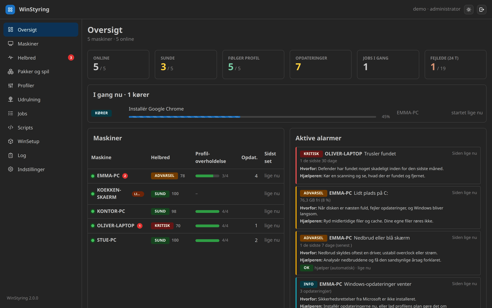
*Oversigten: hvor mange pc'er der er tændt og sunde, hvad der kører lige nu, og hvilke alarmer der kræver opmærksomhed.*

Det består af tre dele:

| Del | Hvad det er | Hvor det kører |
|---|---|---|
| **Serveren** | Hjemmesiden, du styrer det hele fra, og databasen, der husker alt | En Docker-container på en server eller NAS derhjemme (se [installationsvejledningen](docs/installation.md)) |
| **Agenten** | Et lille program, der kører i baggrunden på hver pc og tager imod ordrer fra serveren | På hver pc (Windows-tjeneste eller Linux-tjeneste) |
| **Windows Opsætning** | Værktøj til at geninstallere en pc, så den bliver som før | Fra USB-nøgle eller over netværket |

Serveren gør ikke noget ved en pc, før der er en agent på den. **Agenten er det, der gør en pc "styrbar".**

---

## Hvad kan det?

Når en pc har agenten, kan du fra hjemmesiden:

- **Se status:** Er pc'en tændt? Hvor meget diskplads er der? Hvor varm er den? Er antivirus slået til? Er disken ved at gå i stykker?
- **Installere programmer og spil:** Vælg fx Chrome, Spotify eller et Steam-spil, og tryk "installér". Det sker på pc'en, uden at du skal derhen.
  Der er et katalog med ca. 150 almindelige programmer.
- **Opdatere alt på én gang:** Programmer og Windows Update, med det samme eller automatisk hver nat.
- **Profiler:** Lav fx en profil "Børn" med de programmer, børnene skal have. Sæt profilen på en pc, så sørger Fleetdeck for, at programmerne er der.
- **Alarmer:** Få besked, hvis noget er galt (fuld disk, slukket antivirus, for varm), og lad "hjælperen" rette det for dig.
- **Fjernhandlinger:** Lås skærmen, log brugeren af, send en besked, genstart eller sluk.
- **Natlig vedligeholdelse:** Pc'erne kan tændes om natten, opdateres og slukkes igen.
- **Geninstallere en pc:** Start en helt ny Windows (eller Ubuntu) over netværket, og få programmer, filer og indstillinger lagt tilbage automatisk.

Se [Rundtur i Fleetdeck](#rundtur-i-fleetdeck) længere nede for billeder af de enkelte sider.

---

## Sæt agenten på en pc, der allerede kører

Det her er den almindelige måde at få en pc med. Det tager omkring et minut. Pc'en skal være på samme hjemmenetværk som
Fleetdeck-serveren.

### Trin 1: Hent kommandoen fra Fleetdeck

1. Åbn Fleetdeck i browseren. Adressen er serverens adresse og port 8585, fx `http://192.168.1.10:8585`.
2. Log ind med dit brugernavn og din adgangskode.

   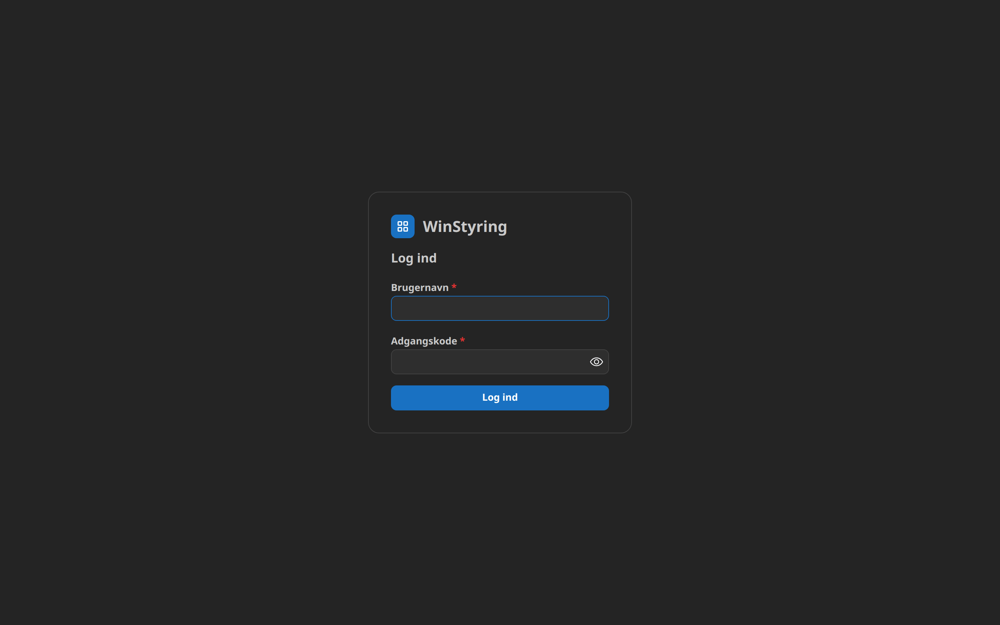

3. Klik på **Maskiner** i menuen.
4. Klik på knappen **+ Tilføj maskine**.
5. Der kommer et vindue, der spørger *Hvad kører maskinen?*. Vælg fanen **Windows** eller **Linux / Raspberry Pi**, og klik på
   den blå knap **Kopiér**.

   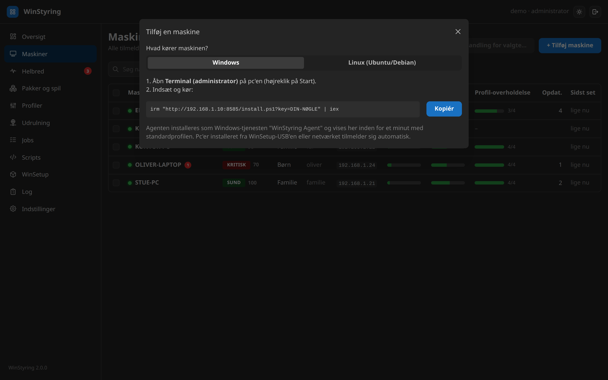
   *Windows-fanen. Kommandoen er klar til at kopiere; nøglen er her erstattet med DIN-NØGLE.*

   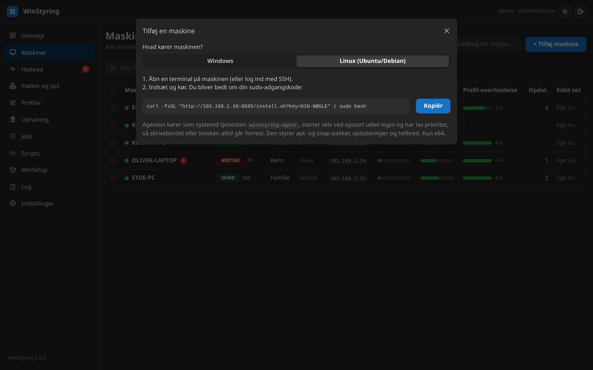
   *Linux-fanen har sin egen kommando.*

Kommandoen indeholder en **tilmeldingsnøgle** (det lange stykke efter `key=`). Den beviser, at pc'en må melde sig til.
Del den ikke med andre end dem, der må tilføje pc'er.

### Trin 2a: På en Windows-pc

1. Gå hen til pc'en, der skal med.
2. **Højreklik** på Start-knappen (Windows-logoet nederst).
3. Vælg **Terminal (administrator)**. På ældre Windows hedder den *Windows PowerShell (administrator)*.
4. Windows spørger "Vil du tillade, at denne app foretager ændringer?". Klik **Ja**.
5. Indsæt kommandoen: højreklik i det sorte vindue, eller tryk **Ctrl+V**. Den ser sådan ud:

   ```powershell
   irm "http://192.168.1.10:8585/install.ps1?key=DIN-NØGLE" | iex
   ```

6. Tryk **Enter**.

Du ser en blå linje "Fleetdeck: henter agenten fra …". Når den er færdig, kører agenten som tjenesten
**Fleetdeck Agent** og ligger i `C:\Program Files\Fleetdeck`. Den starter selv, når pc'en tændes, og opdaterer sig selv.

### Trin 2b: På en Linux-pc (fx Ubuntu)

1. Åbn en terminal (på Ubuntu: **Ctrl+Alt+T**), eller log ind på maskinen med SSH.
2. Indsæt kommandoen (**Ctrl+Shift+V**). Den ser sådan ud:

   ```bash
   curl -fsSL "http://192.168.1.10:8585/install.sh?key=DIN-NØGLE" | sudo bash
   ```

3. Tryk **Enter**, og skriv din adgangskode, når den spørger (der vises ingen tegn, mens du skriver; det er normalt).

Når den skriver "Fleetdeck: færdig", kører agenten som tjenesten **fleetdeck-agent**. Linux-agenten kræver en pc
(x64 eller ARM64) eller en Raspberry Pi (32- eller 64-bit ARM) med systemd, hvilket alle almindelige Ubuntu-, Debian- og Raspberry Pi OS-installationer har. Den kører med lav prioritet,
så skrivebordet altid går forrest, og den kan styre apt- og snap-pakker, opdateringer og helbred.

### Eller: med et vindue i stedet for en kommando

Kan du bedre lide at klikke end at skrive kommandoer, så gør sådan:

- **Windows:** Klik på **Hent Fleetdeck.exe** i vinduet *Tilføj en maskine* (eller hent filen fra repoets *Releases*).
  Dobbeltklik på filen, og svar **Ja**, når Windows spørger om lov. I vinduet trykker du **Find automatisk** (så finder den
  serveren selv på hjemmenettet) eller skriver serverens IP-adresse. Indsæt nøglen, eller hele kommandoen fra Fleetdeck, så
  udfyldes begge felter. Tryk **Test** og derefter **Forbind**. Åbner du filen igen senere, kan du skifte server
  eller fjerne agenten.
- **Linux:** Hent *fleetdeck-agent* (Linux), og kør i en terminal:

  ```bash
  chmod +x fleetdeck-agent && ./fleetdeck-agent setup
  ```

  På et skrivebord kommer der små vinduer; på en maskine uden skærm (fx over SSH) stilles de samme spørgsmål i terminalen.
  Du bliver bedt om din adgangskode, når agenten installeres.

"Find automatisk" virker kun, når pc'en er på samme net som serveren.

### Send et link til den, der skal installere

I vinduet *Tilføj en maskine* står to links til **downloadsiden** (`<server>/hent`). Siden viser kun installationsprogrammerne og
en vejledning til Windows, Linux og Raspberry Pi – intet andet fra Fleetdeck, og den kræver ikke login. Vælg **Link med nøgle**,
så kan modtageren forbinde med det samme (nøglen ligger efter `#` i linket og sendes aldrig til serveren), eller **Link uden nøgle**,
hvis du hellere vil give nøglen på anden vis.

### Linux og Raspberry Pi

Agenten virker på almindelige pc'er (x64), på Raspberry Pi 2/3/4/5 med både 32- og 64-bit styresystem og på Alpine (musl).
Kommandoen finder selv den rigtige udgave og opretter tjenesten for systemets opstartssystem (systemd, OpenRC, runit eller SysV-init).
Programmer installeres og opdateres med distroens egen pakkehåndtering samt snap og flatpak:

| Familie | Distroer | Pakker |
|---|---|---|
| Debian | Ubuntu (og Kubuntu m.fl.), Debian, Linux Mint, Pop!_OS, Zorin, elementary, Raspberry Pi OS, MX, Devuan, Kali | apt |
| Red Hat | Fedora, RHEL, Rocky, AlmaLinux, CentOS, Oracle Linux, Amazon Linux | dnf / yum |
| SUSE | openSUSE Leap og Tumbleweed, SUSE; MicroOS/Aeon/Kalpa | zypper / transactional-update |
| Arch | Arch, Manjaro, EndeavourOS, Garuda, CachyOS, Artix | pacman |
| Uafhængige | Alpine, Void, Solus | apk, xbps, eopkg |
| "Billed-systemer" | Fedora Silverblue/Kinoite, Bazzite, Bluefin, Aurora, SteamOS | rpm-ostree / steamos-update + flatpak |

På billed-systemerne opdateres hele systemet på én gang og bliver aktivt ved næste genstart. "Genstart mangler" virker på alle familier.
Alpine har hverken bash, curl eller sudo fra start: kør først `apk add bash curl` som root, og så kommandoen uden `sudo`.

### Raspberry Pi: lav SD-kort

Fleetdeck kan bygge et færdigt SD-kort til en Raspberry Pi. Kortet skrives med Raspberry Pi Imager på en pc, og Pi'en sætter sig selv op første gang, den starter.

- **Ny Pi:** Tilføj maskine → Linux / Raspberry Pi → **Lav SD-kort**. Vælg model, styresystem, navn, bruger, SSH-nøgle, IP og profil. Pi'en melder sig selv til Fleetdeck og får profilens programmer.
- **Erstat kortet i en Pi, der allerede er i Fleetdeck:** maskinens side → **Lav SD-kort** → *Erstat kortet*. Vælg gendannelsespunkt (det seneste er valgt). Pi'en genskaber sig selv første gang, den starter: samme navn, IP, tjenester og data. Det gamle kort røres aldrig; går noget galt, lægges det i igen.

Sådan skrives kortet: åbn Raspberry Pi Imager → *Vælg styresystem* → *Brug brugerdefineret* → vælg filen → vælg SD-kortet → svar **Nej** til "Tilpas indstillinger" (ellers overskriver Imager Fleetdecks filer) → skriv.

Godt at vide:
- Kortet har ingen adgangskode og ingen nøgler. Kun en engangskode til netop den maskine, der gælder i 24 timer og kun kan bruges én gang. Login sker med SSH-nøglen.
- Fleetdeck vælger selv basisbilledet ud fra gendannelsespunktet (fx Bookworm 32-bit) og afviser en forkert kombination.
- Boot-opsætningen kopieres ikke fra det gamle kort. Det nye kort beholder sin egen `cmdline.txt` og `config.txt`; kun linjerne fra profilen (*Ekstra config.txt-linjer*, *Ekstra cmdline-flag*) flettes ind.
- *Udelad ved nyt kort* (i profilen) er stier fra gendannelsespunktet, der kun hørte til den gamle opsætning, fx `*.bak*`.
- Billedet slettes automatisk efter 24 timer. Hentning kræver administrator og står i revisionsloggen.
- Maskinens side viser første start som en tidslinje: Startet → Tilmeldt → Pakker, filer og tjenester → Genstart → Klar.

### Raspberry Pi: netboot som nødstart

På Pi'ens side → **Netboot som nødstart**. Fleetdecks egen opstartsserver svarer kun de Pi'er, der er slået til dér. Pi'ens opstartsfiler (start.elf, kernel*.img, *.dtb, config.txt og cmdline.txt) skal ligge i `PXE/tftp/<serienummer>/` på WinSetup-sharen. Rodfilsystemet over NFS deles af værten (fx Unraid → Shares → NFS). En container kan ikke dele NFS uden ekstra rettigheder.

### Opsætningsfil

**Indstillinger → Backup → Opsætningsfil**: *Hent opsætning* giver alt det, du har skrevet ind, som én JSON-fil: indstillinger, profiler og maskinernes profil, mærker og beskyttelse. Adgangskoder, nøgler og tokens kommer ikke med. Gem filen privat, og brug *Læs ind* efter en geninstallation.

### Unraid-serveren

Også Unraid-serveren kan styres. Kører Fleetdeck på den samme Unraid, kan Unraid ikke nå containerens egen IP-adresse, så
agenten forbinder gennem en fil i appdata. Åbn Unraids terminal (**>_** øverst til højre) og kør kommandoen fra
*Tilføj en maskine* → Linux → *Selve Unraid-serveren*:

```bash
curl -fsSL --unix-socket /mnt/user/appdata/fleetdeck/fleetdeck.sock "http://localhost/install.sh?key=DIN-NØGLE" | bash
```

Agenten gemmes på USB-stikket og starter selv efter genstart. Plugins og containere vises som programmer, containere med en
ny version vises som opdateringer, og helbred viser diske, temperaturer og om arrayet kører. En anden Unraid-server (der ikke
selv kører Fleetdeck) bruger den almindelige Linux-kommando.

### Mac

Mac'er (Apple Silicon og Intel) forbindes på samme måde som Linux: åbn **Terminal** og kør kommandoen fra fanen **Mac** i
*Tilføj en maskine* eller på downloadsiden. Agenten kører som tjenesten `com.fleetdeck.agent`. Programmer installeres og opdateres
med Homebrew og App Store (udvidelserne *Homebrew* og *App Store*), og macOS-opdateringer installeres med handlingen
*Installér Windows-opdateringer* (den hedder sådan for alle maskiner). Helbred viser diskplads, diskstatus, FileVault, firewall
og Gatekeeper. Uden Apples MDM kan Fleetdeck ikke tvinge indstillinger igennem på en Mac, men alt det andet virker.

### Udvidelser

Nogle funktioner kræver en lille ekstra del på maskinen. Vælg dem med flueben i opsætningsvinduet, eller tryk **Installér** under
**Udvidelser** på maskinens side i Fleetdeck:

| Udvidelse | Giver | Til |
|---|---|---|
| Temperaturmåling | CPU- og GPU-temperatur | Windows |
| Diskhelbred (SMART) | Diskhelbred og -temperatur | Linux (Windows har det indbygget) |
| Sensorer (lm-sensors) | Ekstra temperaturer og blæsere | Linux |
| Fjernskrivebord (RustDesk) | Se og styr skærmen hjemmefra | Windows, Linux og Mac |
| Homebrew | Installation og opdatering af programmer | Mac |
| App Store (mas) | Programmer fra Mac App Store | Mac |
| Programinstallation (winget) | Installation af programmer, hvis winget mangler | Windows |
| Flatpak-programmer | Programmer fra Flathub | Linux |

### Trin 3: Tjek at det virkede

Gå tilbage til Fleetdeck i browseren og åbn **Maskiner**. Efter få sekunder dukker pc'en op med sit navn. Klik på den for
at se status, programmer og helbred. Første gang tager det et øjeblik, før alle oplysninger er hentet.

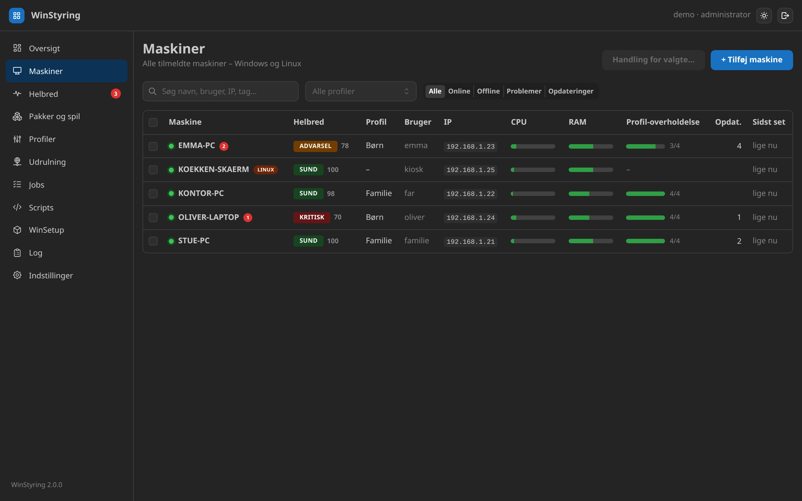
*Maskiner: en grøn prik betyder, at pc'en er online. Helbred, profil, bruger, IP-adresse, CPU, RAM og antal ventende opdateringer
står på samme linje. Den lille røde cirkel ved navnet er antallet af alarmer.*

Nu kan du give pc'en en **profil** eller installere programmer på den.

---

## Hvis noget går galt

| Det ser du | Det betyder det | Gør sådan |
|---|---|---|
| "Kør PowerShell som administrator, og prøv igen." (rød tekst) | Terminalen er ikke åbnet som administrator | Luk den og start forfra fra trin 2a, punkt 2. Husk at vælge **(administrator)** |
| "Fleetdeck: kør med sudo …" | Linux-kommandoen er kørt uden `sudo` | Kopiér hele kommandoen igen; den skal slutte med `\| sudo bash` |
| Fejl om, at serveren ikke kan nås | Pc'en kan ikke komme til serveren | Tjek, at pc'en er på hjemmenetværket (ikke gæstenettet eller VPN), og at adressen åbner i browseren på pc'en |
| "Installationen fejlede (kode …)" | Noget gik galt under installationen, ofte en forkert eller gammel nøgle | Hent kommandoen igen fra **+ Tilføj maskine** (nøglen kan være skiftet) og prøv igen |
| Pc'en dukker ikke op under Maskiner | Agenten kører ikke eller kan ikke nå serveren | Windows: åbn *Tjenester* og se, om **Fleetdeck Agent** kører. Linux: `journalctl -u fleetdeck-agent` viser loggen |

---

## Godt at vide

- **Allerede tilmeldt?** Du kan godt køre kommandoen igen på samme pc. Det skader ikke.
- **Nyinstallation i samme omgang (kun Windows, avanceret):** Skriv først `$env:FLEETDECK_PROVISION = '1'` og tryk Enter,
  før du indsætter kommandoen. Så starter Fleetdeck også hele nyinstallations-sekvensen: drivere, profilens programmer,
  dine filer, baggrund, Windows Update og til sidst en genstart. Brug det kun på en pc, der lige er sat op fra bunden.
- **Ny nøgle:** Under **Indstillinger** (øverst, *Tilføj maskiner*) står Windows-kommandoen også, og knappen **Ny nøgle** laver en ny tilmeldingsnøgle. Den gamle holder så op med at virke for *nye* pc'er,
  men pc'er, der allerede er med, påvirkes ikke.
- **Fjern en pc igen:** Åbn maskinen i Fleetdeck og vælg handlingen **Fjern agenten**.
- **Helt ny pc uden Windows?** Så skal du ikke bruge kommandoen. Brug i stedet USB-nøglen eller netværksinstallation; se
  [VEJLEDNING.md](VEJLEDNING.md), afsnittet *Udrul en pc over netværket* og *B. Tilmeld maskiner*.

---

## Rundtur i Fleetdeck

Menuen i venstre side fører til alle sider. Her er de vigtigste.

### Oversigt


Forsiden. Øverst seks tal: hvor mange pc'er der er **online**, hvor mange der er **sunde**, hvor mange der **følger deres profil**,
hvor mange programopdateringer der venter, hvor mange jobs der kører, og hvor mange der er fejlet det seneste døgn. Under *I gang nu*
ses det, der sker lige nu, med en fremdriftsbjælke. Til højre står de **aktive alarmer** med en forklaring på, *hvorfor* det er et
problem, og hvad *hjælperen* kan gøre ved det.

### Maskiner og en enkelt maskine

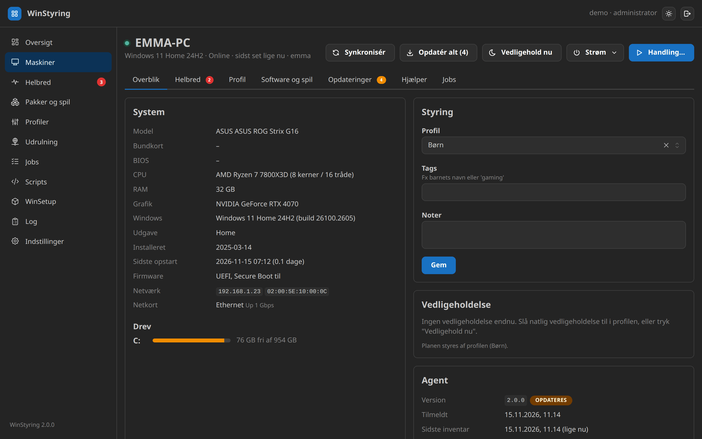

Klik på en pc for at se alt om den. Fanerne øverst er **Overblik** (hardware, Windows-version, netværk), **Helbred**, **Profil**,
**Software og spil**, **Opdateringer**, **Hjælper** og **Jobs**. Knapperne øverst til højre gør noget ved pc'en med det samme:
*Synkronisér* henter friske oplysninger, *Opdatér alt* opdaterer alle programmer, *Vedligehold nu* kører vedligeholdelsen,
*Strøm* genstarter eller slukker (du bliver spurgt først), og *Handling* rummer resten, fx installér et program, send en besked
eller lås skærmen. Til højre vælger du pc'ens **profil** og kan skrive tags og noter.

### Pakker og spil

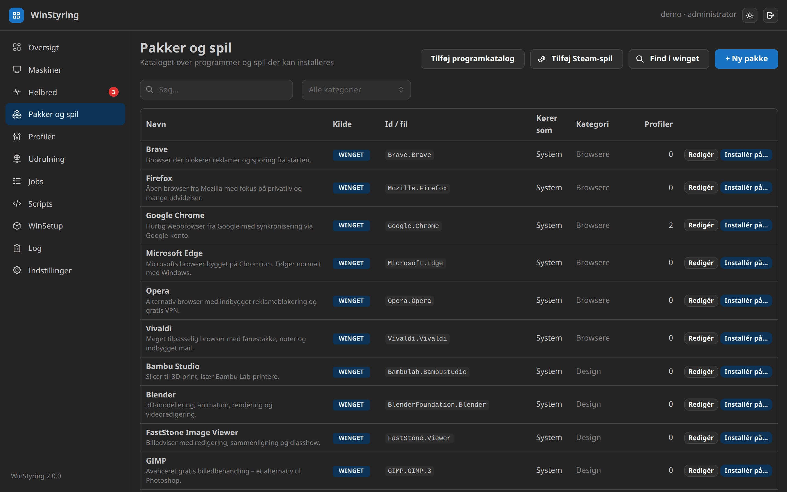

Kataloget over alt, der kan installeres: programmer fra winget, Microsoft Store, Steam-spil og egne installationsfiler.
**Tilføj programkatalog** henter en stor liste af almindelige programmer på én gang, **Find i winget** søger efter flere, og
**Installér på…** sender et program ud til de pc'er, du vælger.

### Profiler

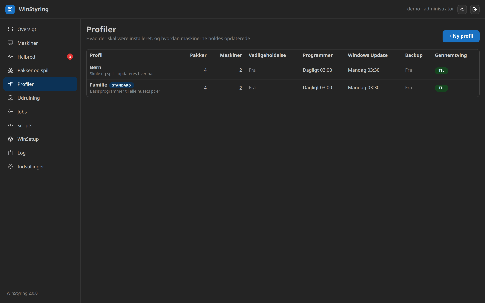

En profil siger, *hvad der skal være på en pc, og hvordan den holdes opdateret*. Eksemplet har en profil **Familie** (standard
for nye pc'er) og en profil **Børn**. Hver profil har sine programmer, hvornår programmer og Windows opdateres (fx dagligt kl. 03:00),
vedligeholdelse og backup. Når *Gennemtving* er slået til, installerer Fleetdeck selv de programmer, der mangler.

### Jobs

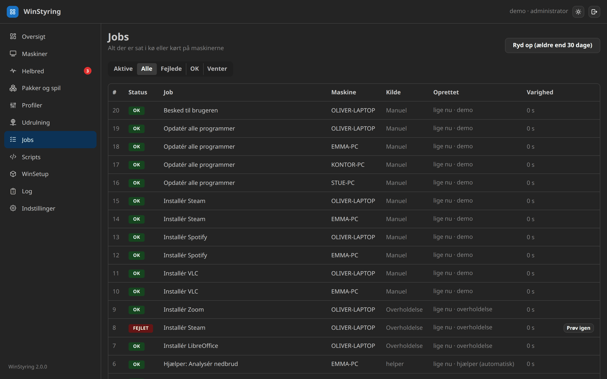

Alt, hvad Fleetdeck har bedt en pc om at gøre, står her: hvad, hvilken pc, hvorfor (*Manuel* = du trykkede, *Overholdelse* =
profilen krævede det, *Hjælper* = hjælperen rettede noget), og hvordan det gik. Et job, der er **fejlet**, kan prøves igen med
**Prøv igen**, og et job, der kører, kan stoppes med **Stop** (agenten lukker så installationen på pc'en). Installationer kører
altid helt uden vinduer. Viser et installationsprogram alligevel en boks (fx "er allerede installeret – vil du erstatte det?"),
svarer agenten selv på den (Ja/OK/Næste – men *Senere* til genstart) og skriver i jobbets output, hvad den svarede. Står en installation
helt stille i 10 minutter uden en boks, stoppes den, og *Opdatér alt* fortsætter med næste program. Står et trin længe stille, viser
jobbet "uændret i X min". Fanerne øverst filtrerer på aktive, fejlede osv.

### Helbred

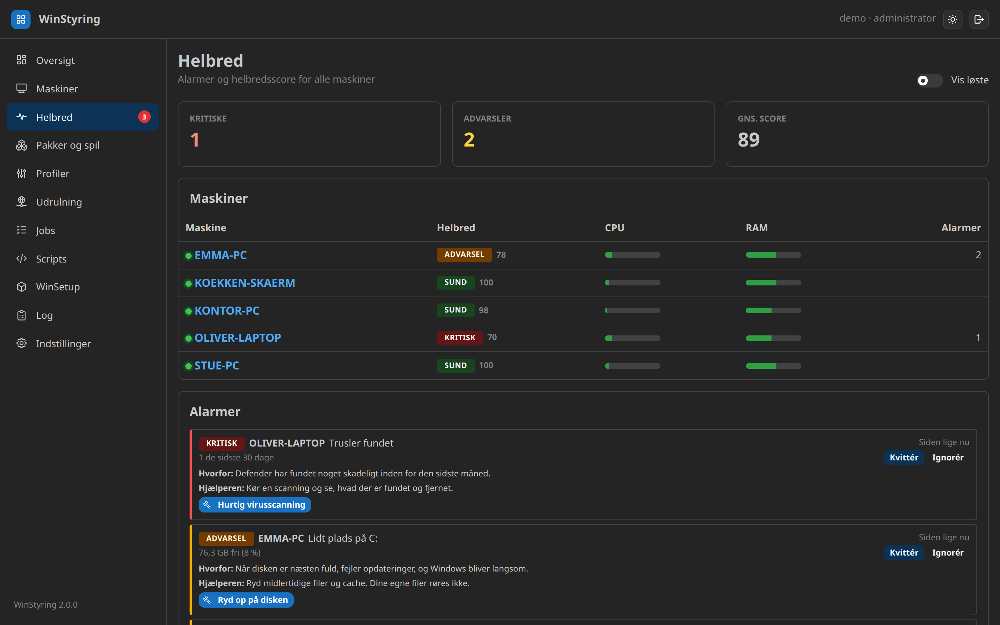

Alle pc'ers helbred samlet: en score fra 0 til 100 pr. pc og alle alarmer. Hver alarm forklarer problemet og har en knap, der
retter det (fx *Hurtig virusscanning* eller *Ryd op på disken*). **Kvittér** fjerner en alarm, du har set, og **Ignorér**
skjuler den type alarm fremover på den pc.

### Indstillinger

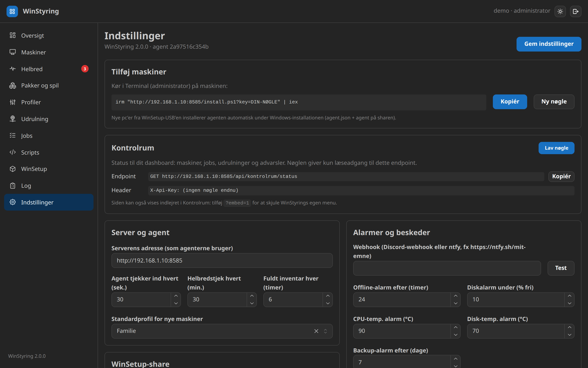

Her står kommandoen til at tilføje maskiner og knappen til en ny tilmeldingsnøgle. Desuden serverens adresse, hvor tit agenterne
melder ind, standardprofilen for nye pc'er og grænserne for alarmer. Du kan også få alarmer sendt videre som besked (Discord eller ntfy).

### På mobilen

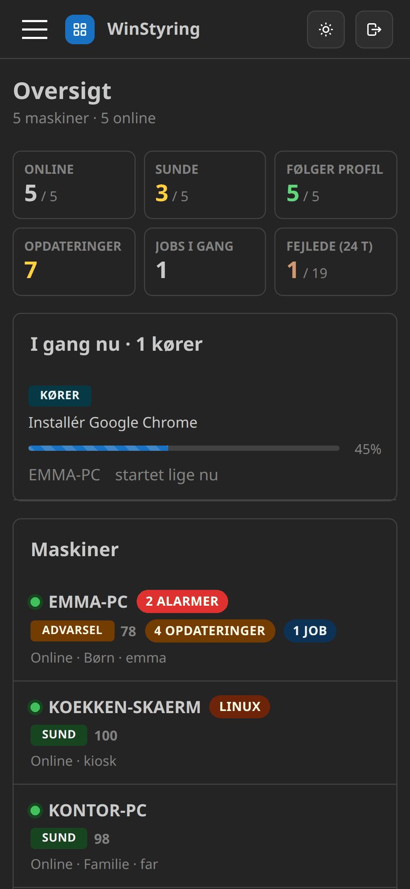

Hele Fleetdeck virker på telefonen. Menuen ligger bag de tre streger øverst til venstre.
