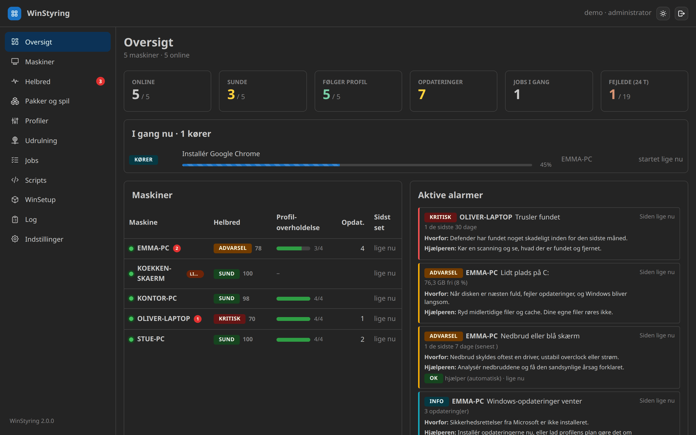

# WinSetup + Fleetdeck

Hjemmets pc-styring i **én Docker-container** – på Unraid, Synology, QNAP, en Linux-server eller en Raspberry Pi.
Installation: [docs/installation.md](docs/installation.md) (docker compose, docker run, Unraid, NAS og ARM64).


*(Demo med fiktive pc'er.)*


- **Fleetdeck** (C# .NET 10 + React/TypeScript): profiler, programmer og spil (winget, Microsoft Store, Steam, programkatalog),
  automatiske opdateringer, Windows Update, scripts, helbred og alarmer, hjælper der retter fejl, børnenes pc'er – på pc og mobil.
- **Udrulning over netværket (PXE, Secure Boot)**: Windows 11 helt ren, med dine ting eller med en profil – og Ubuntu 24.04/26.04
  Desktop/Server. Pc-navn og bruger vælges i Fleetdeck eller i boot-menuen.
- **Windows Opsætning** (PowerShell): USB-installation, backup/gendannelse af filer, indstillinger, baggrund og drivere.
- **Agent** som Windows-tjeneste, der opdaterer sig selv og følger med, hvis serveren flytter.

**Ny her?** Start med [KOM-I-GANG.md](KOM-I-GANG.md): hvad systemet kan, og hvordan du sætter agenten på en pc, der allerede kører.
Den fulde manual er [VEJLEDNING.md](VEJLEDNING.md).

## Sæt agenten på en kørende pc (kort udgave)

Hent kommandoen med din nøgle i Fleetdeck under **Maskiner → + Tilføj maskine**, og kør den på pc'en:

- **Windows:** højreklik Start → **Terminal (administrator)** → indsæt → Enter
  ```powershell
  irm "http://<server>:8585/install.ps1?key=<nøgle>" | iex
  ```
- **Linux (x64, ARM64 eller 32-bit ARM som Raspberry Pi; systemd):**
  ```bash
  curl -fsSL "http://<server>:8585/install.sh?key=<nøgle>" | sudo bash
  ```

Pc'en dukker op under **Maskiner** efter få sekunder. Trin for trin og fejlfinding står i [KOM-I-GANG.md](KOM-I-GANG.md).

## Byg

```bash
docker build -t fleetdeck:latest .
```

Billedet indeholder også Mac-appen som disk-image (`/api/agent/download?platform=mac&kind=dmg&arch=arm64|x64`). Den bygges på Linux uden
Xcode, `hdiutil`, libdmg-hfsplus eller root – og uden ekstra pakker i Docker:

1. `dotnet publish src/Fleetdeck.MacApp -c Release -r osx-arm64` (og `osx-x64`): Avalonia-appen som én selvstændig fil.
2. `fleetdeck-macpack all --publish <mappe> --version <x.y.z> --icon src/Fleetdeck.Agent.Windows/fleetdeck.ico --out Fleetdeck.dmg`
   (`src/Fleetdeck.MacPack`): laver `Fleetdeck.app` (Info.plist med `LSUIElement`, ikon), forsegler den med en ad hoc-signatur
   (`_CodeSignature/CodeResources` + CodeDirectory med SHA-256, som `codesign -s -`), skriver et HFS+-volumen (HFSX) med appen, en genvej
   *Programmer* → `/Applications`, *Læs mig først.txt* og volumen-ikon, og pakker det som komprimeret UDIF (UDZO, zlib + koly-trailer).

Tjek et billede på Linux: `7z t Fleetdeck.dmg`, og `fsck.hfsplus -n -f` (pakken *hfsprogs*) på det rå billede. Testene kører `fsck.hfsplus`
automatisk, hvis den findes (eller `FSCK_HFSPLUS=<sti>` er sat). Appen er ikke købt-signeret hos Apple, så første start kræver
*Åbn alligevel* (macOS 15+) eller højreklik → *Åbn* – se [VEJLEDNING.md](VEJLEDNING.md).

## Licens

Fleetdeck er udgivet under [PolyForm Noncommercial License 1.0.0](LICENSE).
Du må gratis bruge, ændre og dele det til ikke-kommercielle formål: privat, i hjemmet, til hobby, undervisning og i
almennyttige foreninger. Kommerciel brug (fx at sælge det, tilbyde det som betalt tjeneste eller bruge det i en virksomhed)
kræver skriftlig tilladelse fra ophavsmanden.

Medfølgende kode fra andre projekter har sin egen licens, se [THIRD-PARTY-NOTICES.md](THIRD-PARTY-NOTICES.md).
